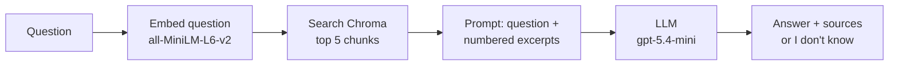

# Ask the pytest docs: RAG with an eval suite

Ask a question about pytest in plain English. The app finds the relevant parts of the official pytest
documentation and an LLM answers **using only those parts**, citing its sources. If the docs don't cover it,
it says so instead of making something up.

The focus of this project is the **eval suite**: 37 pytest tests that measure whether retrieval finds the right
text and whether the answers are correct and grounded.

**Eval score: 37/37 passing** (20 questions: 17 answerable, 3 that must be refused).

## How it works



1. **Ingest:** download 6 pytest doc pages, keep the main text, split it into ~800-character chunks (134 total).
2. **Index:** turn each chunk into an embedding (a list of 384 numbers that captures its meaning) with a free
   local model, and store them in a Chroma vector database.
3. **Retrieve:** embed the question the same way and find the 5 closest chunks.
4. **Generate:** send the question and the chunks to an LLM with strict rules: answer only from the excerpts,
   cite them, and reply with an exact "I don't know" sentence when they don't contain the answer.

## The eval suite

Each case in [`evals/cases.json`](evals/cases.json) has a question, the doc page that should be retrieved, and
**key facts** the answer must contain. It checks facts, not exact text, because LLM wording changes between runs.

| Test | What it checks | Result |
|---|---|---|
| `test_retrieval_has_key_facts` | Search returned chunks that actually contain the key facts (context recall) | 17/17 |
| `test_answer_has_key_facts` | The answer contains the key facts and doesn't wrongly refuse | 17/17 |
| `test_says_i_dont_know` | Off-topic questions, and a pytest topic not in the indexed pages, get the exact refusal | 3/3 |

Testing retrieval and answers separately shows **which stage** failed. Each question costs one LLM call
(results are cached), so a full run costs a fraction of a cent.

### What the evals caught

The first run scored **35/37**. Both failures looked like bad answers, but the cause was retrieval:

- One question got "I don't know", which was correct behaviour, because none of the retrieved chunks contained the answer.
- In the other, the chunk with the key fact ranked 6th, just outside the top 5.

The original retrieval test had passed both, because it only checked that *some* chunk came from the right page.
After making it check for the key facts, I compared chunk sizes (no LLM calls needed):

| Chunk size | Cases with key facts retrieved (k=5) |
|---|---|
| 500 | 15/17 |
| **800** | **17/17** |
| 1000 | 16/17 |
| 1500 | 16/17 |

Switching to 800-character chunks brought the full suite to **37/37**.

**Known limits:**
- The chunk size was tuned on the same questions used for scoring, so the score is somewhat optimistic.
  A held-out test set would make it stricter.
- Keyword checks miss answers that use the right words with the wrong meaning. LLM-as-judge grading is a planned next step.

## Quickstart

Requires Python 3.10+ and an OpenAI API key.

```bash
git clone https://github.com/aleem-afk/pytest-doc-rag-evals.git
cd pytest-doc-rag-evals
python -m venv .venv
# Windows: .venv\Scripts\Activate.ps1    Mac/Linux: source .venv/bin/activate
pip install -r requirements.txt
```

Copy `.env.example` to `.env` and add your API key there. `.env` is git-ignored.

```bash
python ingest.py                         # download and chunk the docs -> data/chunks.json
python build_index.py                    # embed the chunks into chroma_db/
python answer.py How do I skip a test?   # ask a question
python -m pytest -v                      # run the eval suite
```

## Project structure

| File | Purpose |
|---|---|
| `ingest.py` | Download the doc pages, clean them, split them into chunks |
| `build_index.py` | Embed the chunks and store them in Chroma |
| `search.py` | `search(question, k=5)`: semantic search over the chunks |
| `llm.py` | `generate(system, prompt)`: the provider is swappable via `.env` (OpenAI now) |
| `answer.py` | `ask(question)`: the full RAG flow (search, prompt, generate) |
| `evals/cases.json` | The 20 eval questions with expected pages and key facts |
| `evals/test_evals.py` | The pytest eval suite |
| `GUIDE.md` | A step-by-step build log: every command, why it's needed, and lessons learned |

## Tech stack

Python · Chroma · sentence-transformers (all-MiniLM-L6-v2) · OpenAI API · pytest

## Roadmap

- [x] Ingest and chunk the docs
- [x] Vector search with Chroma
- [x] Grounded LLM answers with sources
- [x] Eval suite (37/37)
- [ ] Streamlit web page
- [ ] Public demo on Hugging Face Spaces
- [ ] Gemini as a second provider, compared on the same evals
- [ ] LLM-as-judge grading

## License

[MIT](LICENSE). The indexed documentation excerpts in `data/chunks.json` come from the
[pytest documentation](https://docs.pytest.org/), which is also MIT-licensed.
